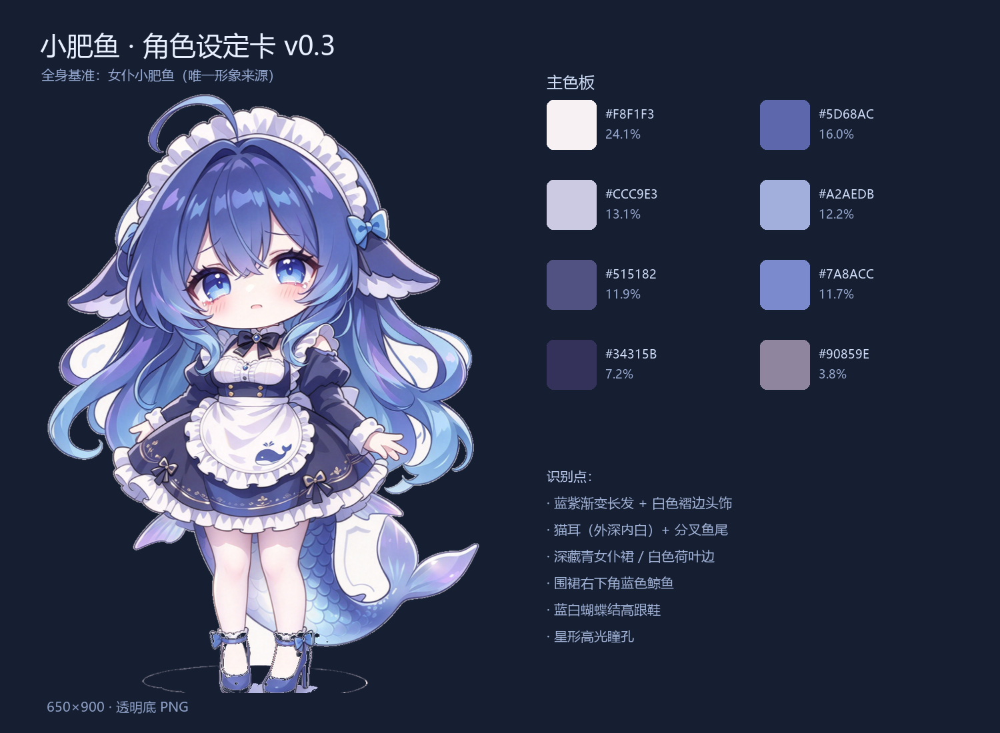

# 小肥鱼 · 角色设定卡 v0.3

> 唯一形象来源：主人提供的全身女仆立绘 `assets/raw/maid.png`。
> v0.3 起废弃双立绘方案（旧图在 `assets/char/legacy/`），全部以本图为基准。

## 身份

| 项 | 内容 |
| --- | --- |
| 名字 | 小肥鱼 |
| 身份 | 桌宠助理 / 女仆 |
| 物种 | 猫耳 + 鱼尾（鲸鱼系） |
| 气质 | 元气、黏人、偶尔傲娇 |
| 构图 | Q 版全身，约三头身，脚踩浅色投影 |

## 外观识别点（改动任意一条都会「不像她」）

1. **蓝紫渐变长发**，过肩及腰，发梢偏冰蓝。
2. **白色褶边女仆头饰**，两侧各一个蓝色蝴蝶结。
3. **猫耳**，外深内白，耳尖带绒毛。
4. **星形高光瞳孔**，蓝底 + 白色四角星。
5. **深藏青女仆裙**，白色荷叶边、胸前黑色蝴蝶结、腰间系带。
6. **白色围裙**，右下角印一只**蓝色鲸鱼**。
7. **分叉鱼尾**（水蓝渐变）与**蓝白蝴蝶结高跟鞋**。

## 主色板

| 色值 | 占比 | 用途 |
| --- | --- | --- |
| `#F8F1F3` | 23.9% | 围裙、头饰、荷叶边 |
| `#5B65A8` | 15.5% | 头发中间调 |
| `#CBC8E3` | 15.4% | 浅紫过渡、高光 |
| `#9DABDB` | 12.0% | 发梢、鱼尾亮部 |
| `#7585C7` | 11.9% | 头发亮部 |
| `#514F7E` | 10.6% | 裙装、头发阴影 |
| `#333059` | 6.7% | 线稿、深色布料 |
| `#9589A1` | 3.9% | 灰紫过渡 |

## 表情与动作

| 状态 | 实现 |
| --- | --- |
| 待机 | 呼吸缩放 + 左右摇摆（3.4s / 4.8s） |
| 生气 | 立绘不换，改用高频抖动 + 气泡变粉红 |
| 被拖动 | 按水平速度倾斜，最大 ±0.14 rad |
| 落地 | 挤压到 0.32 倍后回弹 |
| 眨眼 / 口型 | 待补差分帧 |

## 资产规范

- 源图 837×1089 → 输出 650×900 RGBA PNG，透明底。
- 抠图只去掉「与画布边缘连通的近白像素」，保住白色围裙与荷叶边。
- 立绘自带的脚下投影已按颜色反解去掉，不再跟随角色移动。
- 窗口 260×340，角色按姿态自然尺寸绘制、底部锚定 12px。
- 多姿态：坐姿抱枕 / 眨眼 / 躺姿，统一按头部宽度 192px（2 倍图）归一，显示为 96px。
- 托盘图标从头部区域裁切（约上 36%）。

## 边界

- 不改变发色、服装配色、猫耳、鲸鱼围裙与鱼尾。
- 新增素材必须同角度（正面）、同光照（左上打光）、同头身比。
